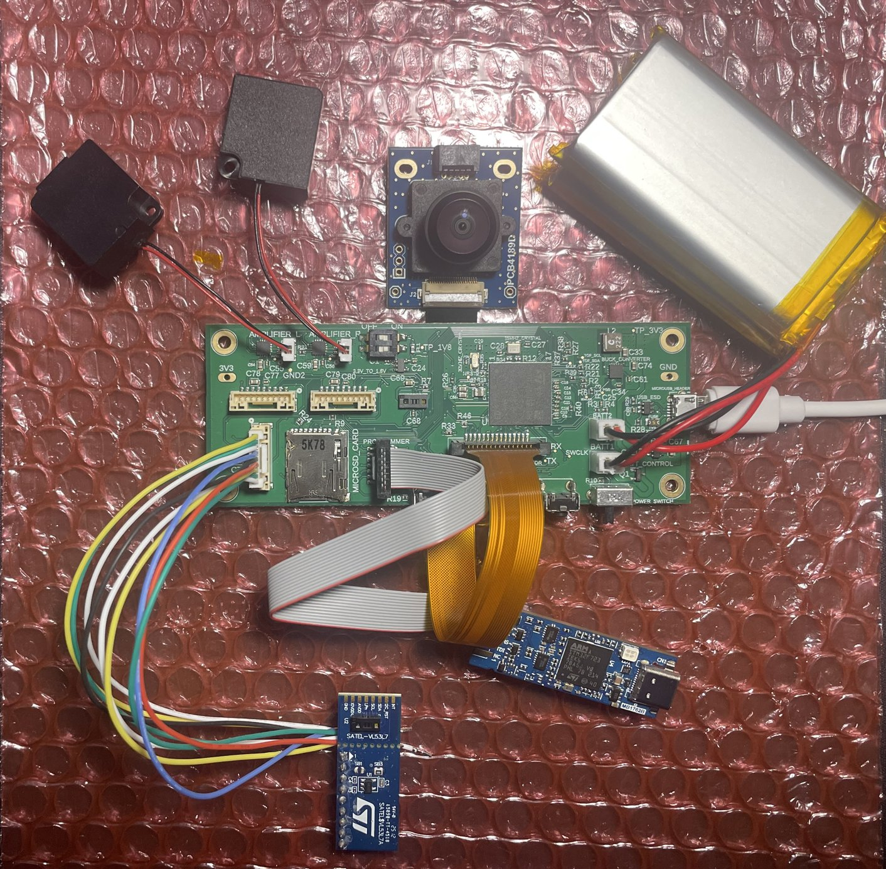
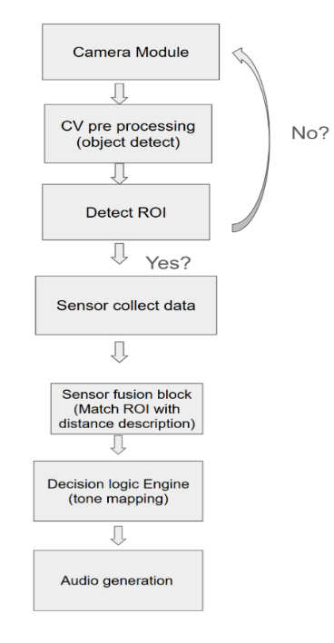
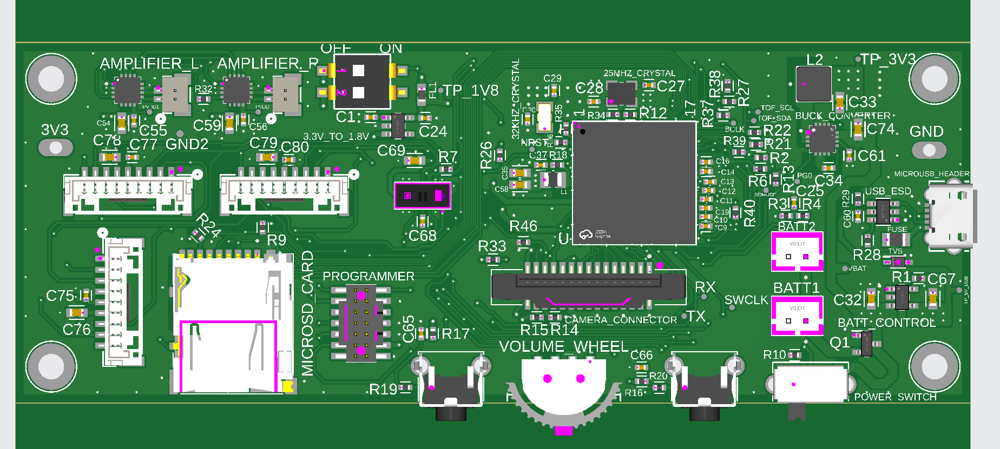
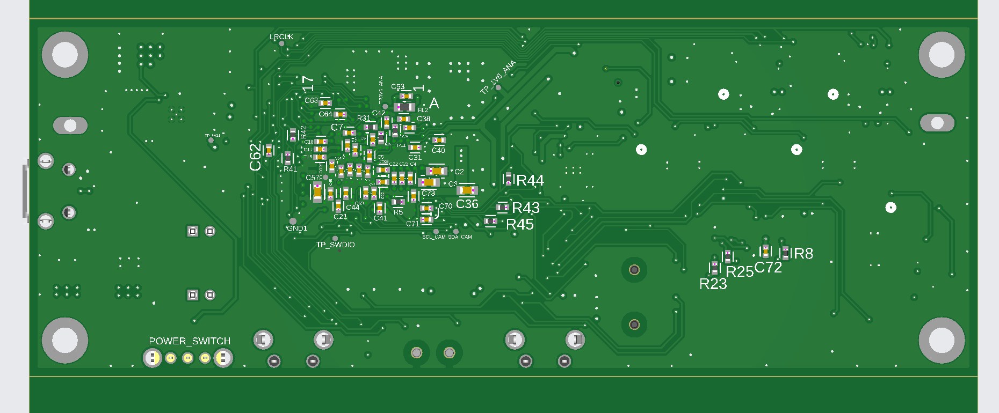
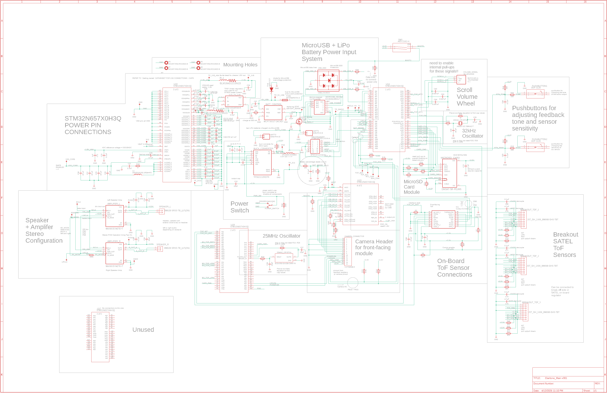
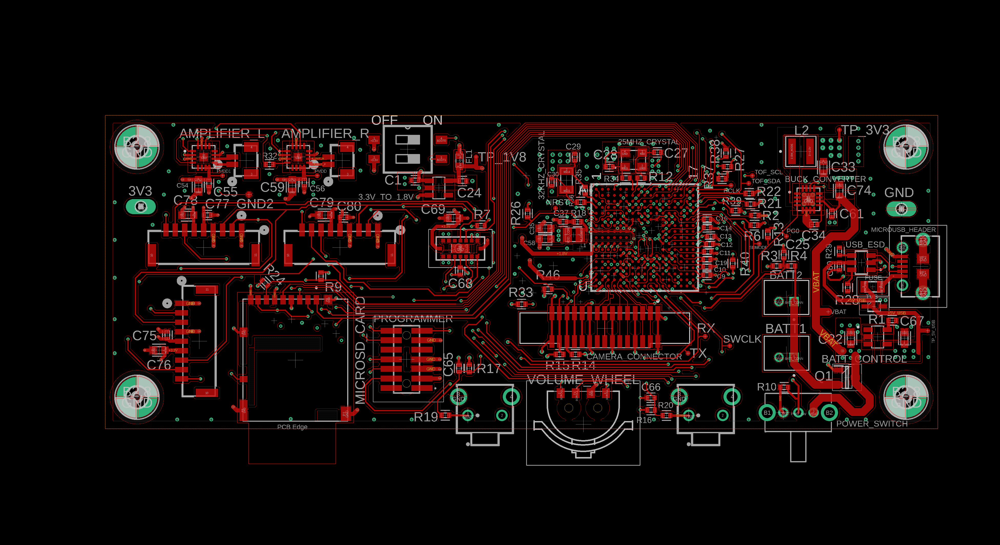
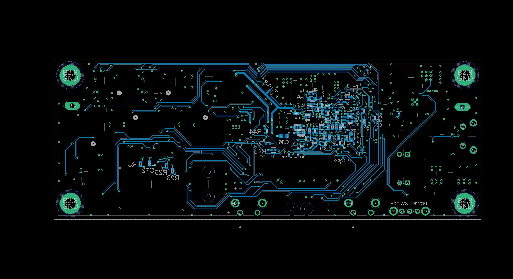

# Claritone

A head-mounted navigation aid for visually impaired users. Time-of-flight (ToF) sensors measure how far away obstacles are, and the device turns that distance into audio cues. The full design adds camera-based object detection and spatial audio. [Status at the showcase](#status-at-the-showcase) covers what actually ran.

Developed as a senior design project (ESE440/ESE441) at Stony Brook University, Fall 2025 – Spring 2026.



## Status at the showcase

**What ran:** the front VL53L7CX sensor drove an audio tone through both speakers. Closer obstacles sound higher, pulse faster and play louder. The user can pick one of three sensitivity ranges (0.3, 0.8 or 1.5 m) and three tone presets, and set volume or mute with the scroll wheel. This is [`firmware/Claritone_L7_Audio`](firmware/Claritone_L7_Audio).

**Designed but not finished:**

- **Side and rear sensors:** the firmware supports four sensors, but only the front one came online.
- **Spatial audio:** Sola's engine (panning, head shadow and interaural delay) is ported to the board in [`firmware/Claritone_Main`](firmware/Claritone_Main). With only the front sensor working, it had no direction to place a sound in.
- **Object detection:** the camera and computer vision work was developed separately in the [team repository](https://github.com/Niefr1/Blindsight-Claritone-Senior-Design) and wasn't combined with the ToF and audio firmware.
- **Battery-saving polling:** the plan was to run every sensor at a low rate and switch the front sensor to high-rate ranging when the camera flags a target.

## System design

The full design runs object detection on the STM32N6's Neural-ART NPU and pairs it with multizone ToF ranging:

1. A pre-trained model from ST's Model Zoo flags a region of interest in the camera frame.
2. The ToF sensors measure how far away that object is.
3. A spatial audio engine places a tone in the obstacle's direction, using equal-power panning, interaural time delay and distance attenuation.



## Hardware

**Custom PCB (Claritone Main Board)**

| Parameter | Value |
|---|---|
| Dimensions | 110 mm x 41.5 mm |
| Layer count | 4-layer FR-4 |
| MCU | STM32N657X0H3Q (Cortex-M55 + Neural-ART NPU, VFBGA-264) |
| ToF sensors | 1x VL53L7CX on-board + 3x SATEL-VL53L7CX breakouts via JST-GH |
| Camera | Arducam IMX335 via 15-pin MIPI CSI FPC connector |
| Audio output | 2x MAX98357A I2S Class-D amplifiers (stereo) |
| Power | 2x 3000 mAh LiPo cells in parallel, MCP73831T charge management, TPS62132 buck (3.3V), TPS7A2018 LDO (1.8V) |
| Protection | Battery reverse-polarity P-MOSFET (DMG2301L), resettable polyfuse (MF-PSMF075X), SD05 TVS diode, USBLC6-2SC6 ESD protection on Micro-USB |
| Charging | Micro-USB (power only) |
| Storage | MicroSD via SDMMC1 |
| Debug | STLINK-V3MINIE via STDC14 header (SWD + VCP) |
| Fabrication | JLCPCB (4-layer, ENIG finish) |




### Schematic



Full schematic PDF: [Claritone_Schematic.pdf](hardware/schematic/Claritone_Schematic.pdf)

### PCB Layout




Full layout PDFs: [Top](hardware/schematic/Claritone_PCB_TOP.pdf) | [Bottom](hardware/schematic/Claritone_PCB_BOTTOM.pdf)

### Design files

The EAGLE 9.7 sources are [`Claritone_Main.sch`](hardware/source/Claritone_Main.sch) and [`Claritone_Main.brd`](hardware/source/Claritone_Main.brd). They open in Autodesk EAGLE 9.7 or later and in Fusion Electronics.

### Bill of materials

[`hardware/bom/claritone-bom.csv`](hardware/bom/claritone-bom.csv) lists every part with a one-line design note ([`.xlsx`](hardware/bom/claritone-bom.xlsx) version).

## Firmware

[`firmware/`](firmware) holds one STM32CubeIDE project per bring-up step, from a pin-toggle test (L0) to the combined program (L8), plus `Claritone_Main`. L7 is the showcase build. [`firmware/README.md`](firmware/README.md) explains what each project does and how to build it.

[`prototypes/spatial-audio`](prototypes/spatial-audio) is Sola's desktop prototype of the spatial audio engine.

## Folder Structure

```
Claritone/
├── firmware/                 # STM32N657 sources and .ioc files
│   ├── Claritone_L0_Blinky/  # bring-up steps L0–L8, one project each
│   ├── ...
│   ├── Claritone_L7_Audio/   # showcase build
│   ├── Claritone_L8_Integration/
│   ├── Claritone_Main/       # spatial audio engine and UI
│   └── claritone-board.ioc   # board pin and peripheral configuration
├── prototypes/
│   └── spatial-audio/        # desktop spatial audio prototype
├── hardware/
│   ├── source/               # EAGLE schematic and board files
│   ├── schematic/            # schematic and layout PDFs and images
│   └── bom/                  # bill of materials
├── docs/
│   └── images/               # photo, renders, block diagram
└── README.md
```

## Building and Flashing

### Requirements
- STM32CubeMX and STM32CubeIDE
- STM32CubeProgrammer (CLI recommended for STM32N6)
- STLINK-V3MINIE debugger (firmware V3J17M10 or later)

### Steps
1. Generate each project's code from its `.ioc` in STM32CubeMX, then add ST's VL53L7CX ULD driver ([details](firmware/README.md#building))
2. Build the FSBL sub-project first
3. Build the Appli sub-project
4. Flash via SWD using STM32CubeProgrammer CLI

> **Note:** The STM32N657 requires dev boot mode (BOOT1 high) for SRAM write access and debug. On the custom PCB, DIP switch SW1 sets BOOT0 and BOOT1. BOOT1 is PA6, with a 10 kΩ pulldown (R46).

## Team

Built by a three-person team at Stony Brook University:

- **[Joseph Cabrera](https://github.com/josephcabrera-cmyk)**: schematic and 4-layer PCB design, board bring-up, ToF sensing architecture, the distance-to-tone mapping in the showcase build, and enclosure design
- **Sola**: the spatial audio engine
- **Joseph** and **Sola**: firmware
- **Felix** and **Sola**: computer vision model selection and deployment on the Neural-ART NPU

The full project, including the computer vision work, is in the [team repository](https://github.com/Niefr1/Blindsight-Claritone-Senior-Design).

## License

This project was developed for academic purposes. The VL53L7CX ULD driver (STSW-IMG036) is not included in this repository due to ST redistribution restrictions. ST's HAL and CMSIS are left out too, since STM32CubeMX regenerates them from each `.ioc`.
